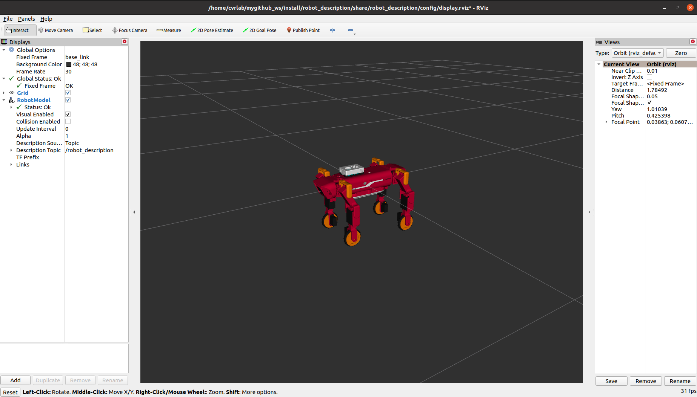

# Wheeled-Quadruped-Robot
ROS 2 and Gazebo-based simulation of a wheeled quadruped robot with terrain classification and fuzzy control.
This project focuses on a four-legged robotic platform equipped with wheels at the end of each leg, enabling both **legged locomotion** and **wheeled locomotion**. The robot is designed to explore locomotion strategies, terrain perception, and control methods for navigating different environments.

## Robot Overview

*Visualization of the wheeled quadruped robot model in ROS 2 RViz2.*

The robot features four articulated legs, each equipped with a wheel, providing a total of **16 degrees of freedom (12 leg joints and 4 wheel joints)**.

## Repository Contents

The following ROS 2 package is currently available:

**`robot_description`**

- Robot model defined using URDF/Xacro.
- 3D mesh files for robot visualization.
- ROS 2 launch file for displaying the robot in RViz2.
- RViz2 visualization configuration.

## Project Status
The robot description and RViz2 visualization are currently available. Additional source code, simulation environments, and documentation will be added in future updates.
